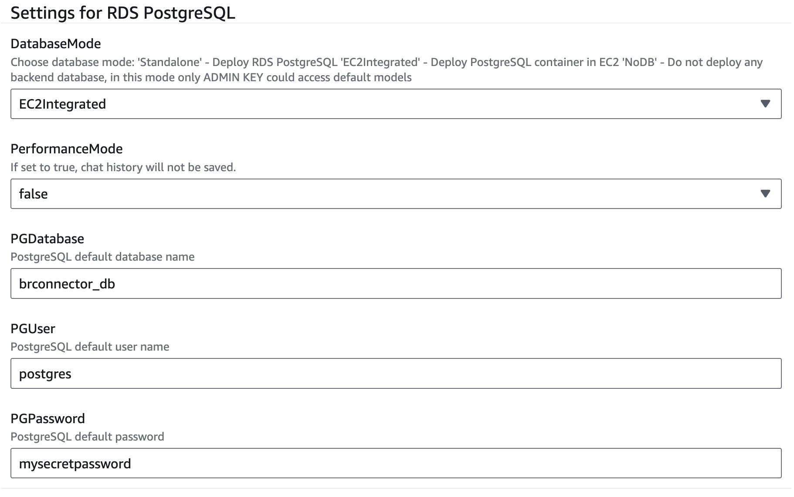
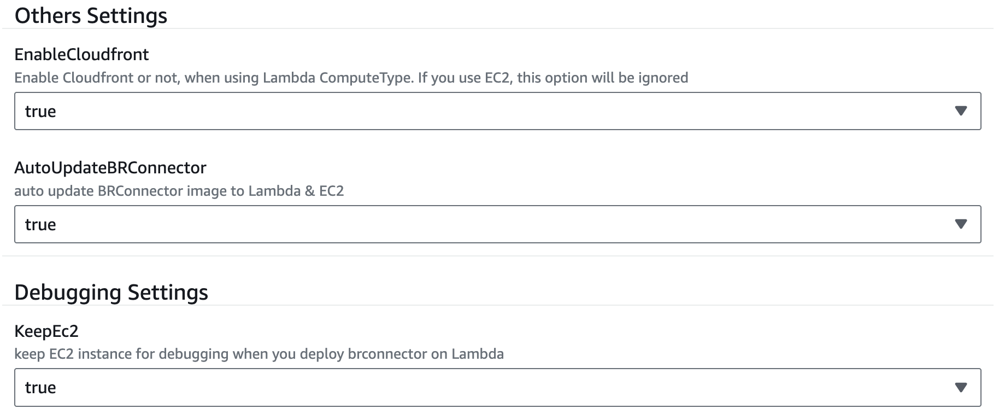
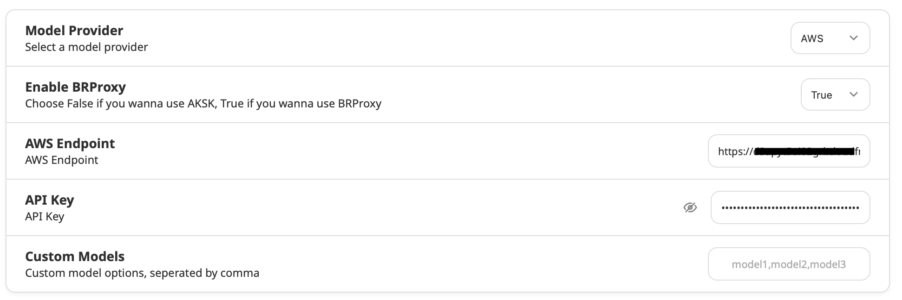

# Quick Deployment

Use CloudFormation for quick deployment.

## Supported Region

`ec2`, `lambda` and `ecs` work in these Regions: us-east-1, us-east-2, us-west-1, us-west-2, ca-central-1, sa-east-1, eu-west-1, eu-west-2, eu-west-3, eu-central-1, eu-north-1, ap-northeast-1, ap-northeast-2, ap-northeast-3, ap-southeast-1, ap-southeast-2 and ap-south-1. `lambda-web` works only where Lambda Web Functions are available: us-east-1, us-east-2, us-west-2, ap-northeast-1 and eu-west-1 (see [AWS Capabilities by Region](https://builder.aws.com/build/capabilities) for the current list). The template refuses `lambda-web` in any other Region.

[Claude Code Web](../user-manual/scenarios/claude-code-web.md) also needs AgentCore Runtime, which is available in all of them except ap-northeast-3, so it cannot run there.

The Lambda@Edge stack for `lambda` with AWS_IAM authorization is always deployed in us-east-1.

## Prerequisites

1. Enable Claude Sonnet 5.5 or Haiku 5.5 - If you are new to using Anthropic models, go to the [Amazon Bedrock console](https://console.aws.amazon.com/bedrock/) and choose **Model access** on the bottom left pane. Request access separately for Claude Sonnet 5.5 or Haiku 5.5.
2. Deploy VPC stack for BRConnector, or pick up an existing VPC for BRConnector, note down VPC ID, 2 public subnet IDs and 2 private subnet IDs
    - here is a cloudformation tempalte for you to quick create VPC and export VPC parameters for you to deploy BRConnector ([brconnector-vpc-cfn.yaml](https://github.com/aws-samples/sample-connector-for-bedrock/raw/main/cloudformation/brconnector-vpc-cfn.yaml))

## Components

Following key components will be included in this Cloudformation template:

- Cloudfront
- BRConnector on ECS, Lambda or EC2
- RDS PostgreSQL or PostgreSQL container on EC2 or without database
- ECR with pull through cache enabled

## Deploy Patterns

Here are some recommend deployment patterns:

- Deploy BRConnector on EC2 with integrated database (or standalone database), put Cloudfront in front of EC2

![[attachments/deployment/IMG-deployment-16.png|600]]

- Deploy BRConnector on Lambda with standalone database (or no database), put Cloudfront  in front of public Lambda function URL
- Deploy BRConnector on Lambda with standalone database (or no database), put Cloudfront  in front of Lambda function URL with AWS_IAM authorization type

![[attachments/deployment/IMG-deployment-17.png|600]]

- Deploy BRConnector on ECS Cluster with standalone database (or no database), put Cloudfront  in front of ALB which expose ECS service.

![[attachments/deployment/IMG-deployment-20.png|600]]


## Deploy Guide

- (Mandatory, if you need lambda function URL with AWS_IAM auth type) deploy lambda@edge at us-east-1 region for Cloudfront Origin Request. After deploy successfully, get lambda version ARN from outputs page. The template publishes version `v2`; when you update an existing Lambda@Edge stack, set the `LambdaEdgeVersionArn` parameter of your BRConnector stack to the new `LambdaEdgeVersionArn` output. <mark style="background: #FFB86CA6;">If skip this step, lambda function URL will be public.</mark>

[![[attachments/deployment/IMG-deployment.png|200]]](https://console.aws.amazon.com/cloudformation/home?region=us-east-1#/stacks/create/template?stackName=lambda-edge-use1&templateURL=https://sample-connector-bedrock.s3.us-west-2.amazonaws.com/lambda-edge-use1.yaml)

- Deploy BRConnector. Download [quick-build-brconnector.yaml](https://github.com/aws-samples/sample-connector-for-bedrock/raw/main/cloudformation/quick-build-brconnector.yaml) and upload to Cloudformation console or click this button to launch directly.

[![[attachments/deployment/IMG-deployment.png|200]]](https://console.aws.amazon.com/cloudformation/home#/stacks/create/template?stackName=brconnector1&templateURL=https://sample-connector-bedrock.s3.us-west-2.amazonaws.com/quick-build-brconnector.yaml)

- VPC parameters
  - Deploy VPC stack first, and put the stack name here.
  - Choose 2 PUBLIC subnets for EC2/ECS and two PRIVATE subnets for Lambda and RDS (subnet group need 2 AZ at least)

![[attachments/deployment/IMG-deployment-18.png]]

- Compute parameters
  - Choose ComputeType for BRConnector, Lambda or EC2
  - For EC2 settings
    - Now only support Amazon Linux 2023
    - You could choose to create PostgreSQL as container in same EC2 (DatabaseMode to `EC2Integrated`), or create standalone RDS PostgreSQL as backend (DatabaseMode to `Standalone`)
  - For Lambda settings
    - `EcrRepo` Define your private repository name prefix string
    - `LambdaArch` Define using arm64 or amd64 for your lambda architecture
    - <mark style="background: #ADCCFFA6;">PUBLIC Function URL</mark> will be used if `LambdaEdgeVersionArn` is NULL. Please ensure this security setting is acceptable
    - And you could choose to create RDS PostgreSQL (DatabaseMode to `Standalone`) or without database (DatabaseMode to `NoDB`)
- For ECS settings
    - Default ECS Task CPU is 1024
    - Default ECS Task Memory is 2GB
    - Default Tasks number in ECS Service is 2

![[attachments/deployment/IMG-deployment-19.png]]

- PostgreSQL parameters
  - DatabaseMode choose:
    - `EC2Integrated` -- Deploy PostgreSQL container in EC2
    - `Standalone` -- Deploy RDS PostgreSQL
    - `NoDB` -- Do not deploy any backend database, in this mode only ADMIN KEY could access default models
  - Set PerformanceMode to true, chat history will not be saved.
  - Leave `PGPassword` empty for a new stack. The stack then generates a password of 32 letters and digits, keeps it in AWS Secrets Manager, and shows the secret's ARN in the `PGPasswordSecretArn` output. The stack parameters, the outputs, the function configuration and the ECS task definition hold no plain-text password; the task definition holds only the secret's ARN. `ec2` reads the password from the secret when the instance boots and keeps it in the root-only files in `/root`. On `ecs`, ECS reads the secret when a task starts and sets `PGSQL_PASSWORD` in the container's runtime environment, as it does for every secret. `lambda` and `lambda-web` read it when they connect to the database, which needs BRConnector 0.0.45 or later: release the BRConnector image (and, for `lambda-web`, the `SourceRef` the package is built from) together with this template, or before it. A `lambda` or `lambda-web` stack that runs an older BRConnector cannot reach its database with a generated password; enter a password for such a stack.
  - To use a password of your own, enter 8 to 128 letters and digits: the EC2 instance does not pass other characters through unchanged.
  - `PGStorageEncrypted` has no default. Choose `true` to encrypt the storage of the RDS database (`Standalone`). Without an RDS database the value is not used, but the template still asks for it.
  - The RDS database has deletion protection. See [Deleting a stack](#deleting-a-stack).



- Debugging parameters
  - If you choose Lambda as ComputeType, you could choose to delete EC2 after all resources deploy successfully. This EC2 is used for compiling and building BRConnector container temporarily.
  - Don't delete EC2 if you choose EC2 as ComputeType
  - If you set `true` to AutoUpdateBRConnector, BRConnector is updated every night; see [AutoUpdate](#autoupdate)



- Until deploy successfully, go to output page and copy Cloudfront URL and first user key to your bedrock client settings page.



- Also you could connect to `BRConnector` EC2 instance with SSM Session Manager ([docs](https://docs.aws.amazon.com/systems-manager/latest/userguide/session-manager-working-with-sessions-start.html#start-ec2-console))

## AutoUpdate

With `AutoUpdateBRConnector` set to `true`, the stack moves BRConnector to `latest` every night at 00:00 UTC, even when `BRConnectorVersion` is pinned to another version.

| ComputeType | What runs at 00:00 UTC |
| --- | --- |
| `ec2` | An SSM association pulls the `latest` image and, when it changed, runs `/root/brconnector-run.sh latest` on the instance. Stacks created before 0.0.44 have no run script: the association replays the `docker run` line logged at first boot instead, with the tag set to `latest`. Each run also restricts the permissions of the boot log and the key files in `/root`. |
| `lambda` | An EventBridge rule starts a CodeBuild project, which copies the `-lambda:latest` image to your private ECR repository and updates the function. |
| `ecs` | No nightly job. |
| `lambda-web` | No nightly job. A stack update rebuilds the package from `SourceRepoUrl` at `SourceRef` and deploys it when `SourceRepoUrl`, `SourceRef` or `WebFnBuildId` changes, and on the first update to a 0.0.44 template. Change `WebFnBuildId` (for example from `1` to `2`) to rebuild without changing anything else. |

The `lambda-web` package serves BRClient at `/brclient/`, like the images. The package build builds it from the upstream commits that `scripts/brclient.source` at `SourceRef` names. See [BRClient source](#brclient-source).

If the update of a `lambda-web` stack fails, CloudFormation rolls it back by building the previous `SourceRef` again, so keep that ref (branch or commit) available in the repository until the update completes. If the rollback build fails too, the stack ends in `UPDATE_ROLLBACK_FAILED`. Recover with:

```sh
aws cloudformation continue-update-rollback --stack-name <stack name> --resources-to-skip WebFnPackage
```

With `AutoUpdateBRConnector` set to `false`:

- Go to the CodeBuild page; one project could be triggered to update your lambda image manually. Click `Start build`.
- Images in EC2 will NOT be updated by SSM State Manager automatically, because no association is created. Use the SSM document to run the update on EC2 manually.
- Check your ECR settings: if there are rules in the pull through cache page, you have enabled this feature to update the ECR image with the upstream repository automatically.

## BRClient source {#brclient-source}

BRConnector serves the BRClient web app at `/brclient/`. The `ec2`, `ecs` and `lambda` images and the `lambda-web` package build it from the source of [sample-client-for-amazon-bedrock](https://github.com/aws-samples/sample-client-for-amazon-bedrock), at the commits that `scripts/brclient.source` names:

- `BRCLIENT_BASE` is a commit of upstream `main`.
- `BRCLIENT_PR` and `BRCLIENT_PR_HEAD` name an upstream pull request that is not merged yet, and its head commit. The build merges that head into the base. Both are empty when the build needs no pull request.

`scripts/fetch-brclient.sh` builds BRClient with node 22 and the yarn version that the BRClient source names. When `node` is another version and nvm is installed, it takes node 22 from nvm. It fetches the pinned commits by commit id, so it builds exactly those commits or stops. It does not check whether the pull request is merged. That is decided when `scripts/brclient.source` is written. Each build downloads the BRClient source from GitHub and its dependencies from the npm registry.

The build output contains `brclient/.source`. It repeats the pinned values and adds `BRCLIENT_TREE`, the git tree id of the source that was built. Artifacts with the same `BRCLIENT_TREE` were built from the same source. A multi-platform image build builds BRClient once, so its amd64 and arm64 images carry the same files.

### Before a release {#before-a-release}

1. Run `node scripts/resolve-brclient.mjs`. It reads upstream `main` and the pull request named in the current `scripts/brclient.source` from the GitHub API, and writes the file again:
    - While the pull request is open, the file pins `main` and the pull request's current head.
    - After the pull request is merged, the file pins `main` only and the pull request values are empty. Later runs keep pinning `main` only.
2. Commit `scripts/brclient.source` with the release.
3. Optional: run `bash scripts/fetch-brclient.sh build/brclient` and check `build/brclient/.source`.

To pin another pull request, run `node scripts/resolve-brclient.mjs --pr <number>`. To pin `main` only, run `node scripts/resolve-brclient.mjs --pr none`. The script stops when the pull request was closed without merging, does not target `main`, or is merged but not yet in the `main` it read. The build stops when the pull request does not merge into the pinned `main`. Then run step 1 again after the conflict is fixed upstream, or pin `main` only.

## Template updates of existing stacks

Updating a stack to the 0.0.44 template changes the instance's UserData, so:

- An `ec2` instance is stopped and started once, which is a short outage.
- `lambda` and `lambda-web` stacks created with `KeepEc2` set to `false` cannot take the update, because the helper instance deleted itself. Recreate them.
- `lambda-web` applies the database migrations when it starts, including the 0.0.43 migrations if they were never applied, which delete the models of retired providers (see 0.0.43 in the [changelog](changelogs.md)). Take a database snapshot before you update.
- Set `LambdaEdgeVersionArn` to the output of the new Lambda@Edge stack (version `v2`) when you use AWS_IAM authorization on the function URL.

A template that has the `PGStorageEncrypted` parameter also changes the RDS database (`Standalone`). The update keeps the database, its data and its password:

- Keep the current value of `PGStorageEncrypted`. For a stack created from an earlier template, that is `false`: its database is not encrypted. `true` replaces it with a new, empty database, which BRConnector then uses. CloudFormation takes a snapshot of the old database and deletes it, or, when the old database has deletion protection (after this update), leaves it running outside the stack, billed until you delete it.
- Keep the current `PGPassword`. The console fills it in. With the AWS CLI, pass `ParameterKey=PGPassword,UsePreviousValue=true`: without it, the update takes the empty default and generates a new password. A stack created with a password keeps it, and the update creates no secret. Do not clear `PGPassword` on such a stack, and do not enter one on a stack that generated its password: either change sets a new database password, and on `ec2` it stops and starts the instance without updating `/root/brconnector-run.sh`, so BRConnector keeps the old password.
- The update turns on deletion protection for the database, without an interruption. See [Deleting a stack](#deleting-a-stack).
- On `brconnector-ecs-fargate.yaml`, keep the current `PGUser` as well. It has no default now, and a new user name replaces the database.
- The template now lists the outbound rules of each security group and sets the database to not publicly accessible. The rules allow all IPv4 and all IPv6 traffic, which are the rules EC2 adds to a security group that lists none. The update modifies these resources, but outbound traffic and access to the database stay the same. In a VPC without IPv6, the IPv6 rule matches no traffic.

## Deleting a stack {#deleting-a-stack}

The RDS database has deletion protection, so a stack deletion stops at the database (`MyPG` in `DELETE_FAILED`). To delete the stack:

1. Turn off deletion protection. The database identifier is the physical ID of `MyPG` on the **Resources** tab of the stack.

    ```sh
    aws rds modify-db-instance --db-instance-identifier <database> --no-deletion-protection --apply-immediately
    ```

2. Delete the stack again.

A stack update that removes the database, for example a change of `DatabaseMode`, cannot delete it either. While deletion protection is on, the database stays, running outside the stack.

When CloudFormation deletes the database, it first takes a final snapshot, as it did with earlier templates. A generated password is deleted with the stack, so set a new master password when you restore the snapshot. The snapshot stays after the stack is deleted, and it is billed until you delete it:

```sh
aws rds describe-db-snapshots --db-instance-identifier <database> --snapshot-type manual --query 'DBSnapshots[].[DBSnapshotIdentifier,SnapshotCreateTime]' --output text
aws rds delete-db-snapshot --db-snapshot-identifier <snapshot>
```

## Admin key on stacks created before 0.0.44 {#admin-key-before-0-0-44}

On stacks created before 0.0.44, the admin key was written to the boot log (`/var/log/cloud-init-output.log`) and the console output of the stack's EC2 instance: the BRConnector instance on `ec2`, the helper instance on `lambda`, `lambda-web` and `ecs`. Rotate the admin key if anyone other than the stack's admins can log in to that instance or read its console output.

If the stack has a database, the same log also holds the API key of the first user the stack created (`/brconnector/first-user-key-<stack name>`). If that key is still in use, reset it in the admin console: **API Keys**, then **Reset**.

After the template update, the nightly update of `ec2` stacks with `AutoUpdateBRConnector` set to `true` makes the boot log and the key files in `/root` readable by root only. On any other instance that is still running, do it once by hand:

```sh
sudo sh -c 'chmod 600 /var/log/cloud-init-output.log /root/*.txt'
```

### ec2

BRConnector gets the key from its `docker run` command. Unless `/root/brconnector-run.sh` exists, the nightly update of these stacks replays the command logged at first boot, which holds the old key. So:

1. If `AutoUpdateBRConnector` is `true`, update the stack to the 0.0.44 template first: the nightly update of earlier templates always replays the logged command.
2. Connect to the instance with Session Manager and run the commands below, with your stack name in place of `<stack name>`. They write `/root/brconnector-run.sh` from the logged command with a new key, restart BRConnector on the image tag it runs now, and store the new key in the SSM parameter. BRConnector is unavailable for a few seconds.

    ```sh
    sudo -i
    NEW_KEY=$(uuidgen)
    umask 077
    {
      echo '#!/bin/bash -e'
      egrep -o 'docker run .* --name brconnector .*' /var/log/cloud-init-output.log | tail -n 1 |
        sed -e "s/ADMIN_API_KEY=[^ ]*/ADMIN_API_KEY=$NEW_KEY/" -e 's/:[^:]*$/:"${1:-latest}"/'
    } > /root/brconnector-run.sh
    chmod 700 /root/brconnector-run.sh
    echo "$NEW_KEY" > /root/admin-api-key.txt
    TAG=$(docker inspect -f '{{.Config.Image}}' brconnector | sed 's/.*://')
    docker rm -f brconnector && bash /root/brconnector-run.sh "$TAG"
    aws ssm put-parameter --name /brconnector/admin-key-<stack name> --value "$NEW_KEY" --type String --overwrite
    ```

3. Sign in to the admin console with the new key. From then on, the nightly update and the [manual update](#brconnector-on-ec2) run the new script.

### lambda, lambda-web and ecs

BRConnector reads the key from `ADMIN_API_KEY` in its environment: the function's environment variables on `lambda`, the Web Function revision on `lambda-web`, the task definition on `ecs`. CloudFormation set it from the SSM parameter when it created that resource, so writing a new value to the parameter does not change it.

1. If the helper instance is still running (`KeepEc2` set to `true`), it also runs BRConnector, with the old key and the stack's database. Run step 2 of the `ec2` steps on it; that also stores the new key in the parameter. Without a helper instance, generate a new key, for example with `uuidgen`, and store it with `aws ssm put-parameter --name /brconnector/admin-key-<stack name> --value <new key> --type String --overwrite`.
2. Set `ADMIN_API_KEY` to the new key. Read it with `aws ssm get-parameter --name /brconnector/admin-key-<stack name> --query Parameter.Value --output text`.
    - `lambda`: in the Lambda console, open the function named in the `MyFunctionName` output, choose **Configuration**, **Environment variables**, **Edit**, change `ADMIN_API_KEY` and save. New requests use the new key.
    - `ecs`: in the Amazon ECS console, create a new revision of the task definition `<stack name>-task` with the new `ADMIN_API_KEY` on the `brconnector` container, then update the service `<stack name>-service` in the cluster `<stack name>-cluster` to that revision. The service replaces its tasks.
    - `lambda-web`: this page has no procedure yet. A Web Function revision cannot be changed, and it has not been verified whether the revision that a stack update creates takes the new value from the parameter.
3. These changes are made outside CloudFormation. A later stack update that changes the function, the task definition or the service can set the old value again, so check `ADMIN_API_KEY` after such an update.

## CloudFront to origin

CloudFront reaches the origin over HTTP for `ec2` and `ecs`. For `lambda-web` the connection is HTTPS from the viewer to the Web Function.

### ECR without pull through cache enabled (only for previous cfn version)

- following this script to update image manually if you do not enable ECR pull through cache

```sh
export AWS_DEFAULT_REGION=us-west-2
export ACCOUNT_ID=00000000000000
export PrivateECRRepository=your_private_repo_name

aws ecr get-login-password --region ${AWS_DEFAULT_REGION} | docker login --username AWS --password-stdin ${ACCOUNT_ID}.dkr.ecr.${AWS_DEFAULT_REGION}.amazonaws.com

# pull/tag/push arm64 image for lambda
docker pull --platform=linux/arm64 public.ecr.aws/x6u9o2u4/sample-connector-for-bedrock-lambda
docker tag public.ecr.aws/x6u9o2u4/sample-connector-for-bedrock-lambda ${ACCOUNT_ID}.dkr.ecr.${AWS_DEFAULT_REGION}.amazonaws.com/${PrivateECRRepository}:arm64
docker push ${ACCOUNT_ID}.dkr.ecr.${AWS_DEFAULT_REGION}.amazonaws.com/${PrivateECRRepository}:arm64

# pull/tag/push amd64 image for lambda
docker pull --platform=linux/amd64 public.ecr.aws/x6u9o2u4/sample-connector-for-bedrock-lambda
docker tag public.ecr.aws/x6u9o2u4/sample-connector-for-bedrock-lambda ${ACCOUNT_ID}.dkr.ecr.${AWS_DEFAULT_REGION}.amazonaws.com/${PrivateECRRepository}:amd64
docker push ${ACCOUNT_ID}.dkr.ecr.${AWS_DEFAULT_REGION}.amazonaws.com/${PrivateECRRepository}:amd64

# create/push manifest file
docker manifest create ${ACCOUNT_ID}.dkr.ecr.${AWS_DEFAULT_REGION}.amazonaws.com/${PrivateECRRepository}:latest --amend ${ACCOUNT_ID}.dkr.ecr.${AWS_DEFAULT_REGION}.amazonaws.com/${PrivateECRRepository}:arm64 --amend ${ACCOUNT_ID}.dkr.ecr.${AWS_DEFAULT_REGION}.amazonaws.com/${PrivateECRRepository}:amd64
docker manifest annotate ${ACCOUNT_ID}.dkr.ecr.${AWS_DEFAULT_REGION}.amazonaws.com/${PrivateECRRepository}:latest ${ACCOUNT_ID}.dkr.ecr.${AWS_DEFAULT_REGION}.amazonaws.com/${PrivateECRRepository}:arm64 --os linux --arch arm64
docker manifest annotate ${ACCOUNT_ID}.dkr.ecr.${AWS_DEFAULT_REGION}.amazonaws.com/${PrivateECRRepository}:latest ${ACCOUNT_ID}.dkr.ecr.${AWS_DEFAULT_REGION}.amazonaws.com/${PrivateECRRepository}:amd64 --os linux --arch amd64
docker manifest push ${ACCOUNT_ID}.dkr.ecr.${AWS_DEFAULT_REGION}.amazonaws.com/${PrivateECRRepository}:latest

```

- update lambda image with correct architecture


### BRConnector on EC2

- login to ec2 to update local image and restart brconnector container. Run the commands as root (`sudo -i`): the run script and the boot log are readable by root only. Stacks created before 0.0.44 have no `/root/brconnector-run.sh` unless you wrote one (see [Admin key on stacks created before 0.0.44](#admin-key-before-0-0-44)); replay the logged line instead: `cat /var/log/cloud-init-output.log |egrep -o 'docker run .* --name brconnector .*' |sed 's/:[^:]\+$/:latest/' |sh`

```sh
sudo -i
aws ecr-public get-login-password --region us-east-1 | docker login --username AWS --password-stdin public.ecr.aws
docker pull public.ecr.aws/x6u9o2u4/sample-connector-for-bedrock
docker rm -f brconnector
bash /root/brconnector-run.sh latest

```

## Migrating to new PostgreSQL database
You could choose to deploy PostgreSQL in container on ECR or in RDS directly, here list some command for your reference to migrate your data in PG.

### Migrating BRConnector data from PG container on EC2 to RDS
- list your database name
```sh
docker exec -it postgres psql -U postgres
postgres=> \l # list databases
postgres=>

```
- dump full db 
```sh
docker exec -i postgres pg_dump -U postgres -d brproxy_dbname > db.sql

```
- Find your PG endpoint in RDS
- we will run a docker on your local as postgres client temporarily, instead of install postgresql
```sh
POSTGRES_VERSION=16
docker run --name postgres-client \
    -e POSTGRES_PASSWORD=postgres-client-tmp-password \
    -d postgres:${POSTGRES_VERSION}

```
- copy full db sql to container's /tmp folder
```sh
docker cp db.sql postgres-client:/tmp/

```
- create target database in RDS and import data
```
docker exec -it postgres-client sh 
#
# psql -U postgres -h pg-endpoint.xxx.us-west-2.rds.amazonaws.com 
Password for user postgres:
postgres=> CREATE DATABASE brconnector_db;
postgres=> ^D
# psql -U postgres -h pg-endpoint.xxx.us-west-2.rds.amazonaws.com -d brconnector_db </tmp/db.sql
Password for user postgres:
# 
```
- clean temporary docker on local
```sh
docker rm -f postgres-client

```


