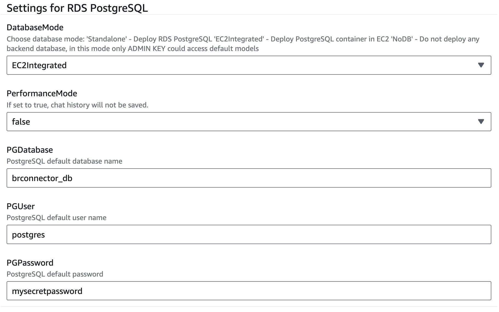
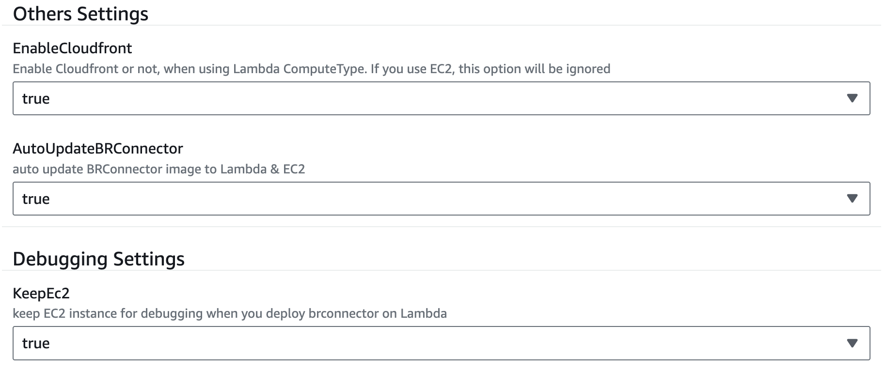
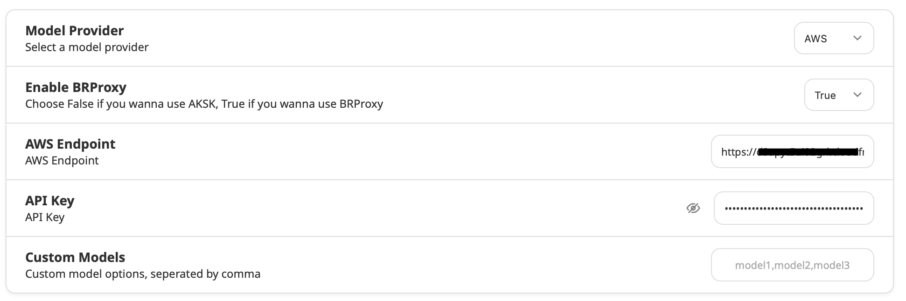

# 快速部署

使用 CloudFormation 进行快速部署。

## 支持的区域 {#supported-region}

`ec2`、`lambda`、`ecs` 可以用在这些区域：us-east-1、us-east-2、us-west-1、us-west-2、ca-central-1、sa-east-1、eu-west-1、eu-west-2、eu-west-3、eu-central-1、eu-north-1、ap-northeast-1、ap-northeast-2、ap-northeast-3、ap-southeast-1、ap-southeast-2、ap-south-1。`lambda-web` 只能用在提供 Lambda Web Functions 的区域：us-east-1、us-east-2、us-west-2、ap-northeast-1、eu-west-1（最新列表见 [AWS Capabilities by Region](https://builder.aws.com/build/capabilities)）。模板会在其他区域拒绝 `lambda-web`。

[Claude Code Web](../user-manual/scenarios/claude-code-web.md) 还需要 AgentCore Runtime，除 ap-northeast-3 外这些区域都提供，所以它不能在 ap-northeast-3 运行。

`lambda` 使用 AWS_IAM 认证时所需的 Lambda@Edge stack 始终部署在 us-east-1。

## 前提条件

1. 启用 Claude Sonnet 5.5 或 Haiku 5.5 - 如果您是首次使用 Anthropic 模型，请访问 [Amazon Bedrock 控制台](https://console.aws.amazon.com/bedrock/)，在左侧窗格底部选择 **Model access**。分别为 Claude Sonnet 5.5 或 Haiku 5.5 请求访问权限。
2. 为 BRConnector 部署 VPC 堆栈，或选择现有的 VPC 用于 BRConnector，记下 VPC ID、2 个公有子网 ID 和 2 个私有子网 ID
    - 这里提供了一个 cloudformation 模板，供您快速创建 VPC 并导出 VPC 参数以部署 BRConnector ([brconnector-vpc-cfn.yaml](https://github.com/aws-samples/sample-connector-for-bedrock/raw/main/cloudformation/brconnector-vpc-cfn.yaml))

## 组件

此 CloudFormation 模板将包含以下关键组件：

- Cloudfront
- 在 Lambda 或 EC2 上运行的 BRConnector
- RDS PostgreSQL、EC2 上的 PostgreSQL 容器或无数据库
- 启用了 pull through 缓存的 ECR

## 部署模式

以下是一些推荐的部署模式：

- 在 EC2 上部署带有集成数据库（或独立数据库）的 BRConnector，在 EC2 前面配置 Cloudfront

![[attachments/deployment/IMG-deployment-16.png|600]]

- 在 Lambda 上部署带有独立数据库（或无数据库）的 BRConnector，在公共 Lambda 函数 URL 前面配置 Cloudfront
- 在 Lambda 上部署带有独立数据库（或无数据库）的 BRConnector，在具有 AWS_IAM 授权类型的 Lambda 函数 URL 前面配置 Cloudfront

![[attachments/deployment/IMG-deployment-17.png|600]]

- 在 ECS 集群上部署带有独立数据库（或无数据库）的 BRConnector，在暴露 ECS 服务的 ALB 前面配置 Cloudfront

![[attachments/deployment/IMG-deployment-20.png|600]]

## 部署指南

- （如果需要带有 AWS_IAM 认证类型的 lambda 函数 URL，则必须执行此步骤）在 us-east-1 区域部署 lambda@edge 用于 Cloudfront Origin Request。部署成功后，从输出页面获取 lambda 版本 ARN。模板发布的版本是 `v2`；更新已有的 Lambda@Edge stack 后，把 BRConnector stack 的 `LambdaEdgeVersionArn` 参数设为新的 `LambdaEdgeVersionArn` 输出。<mark style="background: #FFB86CA6;">如果跳过此步骤，lambda 函数 URL 将是公开的。</mark>

[![[attachments/deployment/IMG-deployment.png|200]]](https://console.aws.amazon.com/cloudformation/home?region=us-east-1#/stacks/create/template?stackName=lambda-edge-use1&templateURL=https://sample-connector-bedrock.s3.us-west-2.amazonaws.com/lambda-edge-use1.yaml)

- 部署 BRConnector。下载 [quick-build-brconnector.yaml](https://github.com/aws-samples/sample-connector-for-bedrock/raw/main/cloudformation/quick-build-brconnector.yaml) 并上传到 Cloudformation 控制台，或点击此按钮直接启动。

[![[attachments/deployment/IMG-deployment.png|200]]](https://console.aws.amazon.com/cloudformation/home#/stacks/create/template?stackName=brconnector1&templateURL=https://sample-connector-bedrock.s3.us-west-2.amazonaws.com/quick-build-brconnector.yaml)

- VPC 参数
  - 首先部署 VPC 堆栈，并在此处填写堆栈名称。
  - 为 EC2/ECS 选择 2 个公有子网，为 Lambda 和 RDS 选择 2 个私有子网（子网组至少需要 2 个可用区）

![[attachments/deployment/IMG-deployment-18.png]]

- 计算参数
  - 为 BRConnector 选择计算类型，Lambda 或 EC2
  - EC2 设置
    - 目前仅支持 Amazon Linux 2023
    - 您可以选择在同一 EC2 上创建 PostgreSQL 容器（DatabaseMode 设为 `EC2Integrated`），或创建独立的 RDS PostgreSQL 作为后端（DatabaseMode 设为 `Standalone`）
  - Lambda 设置
    - `EcrRepo` 定义您的私有仓库名称前缀字符串
    - `LambdaArch` 定义您的 lambda 架构使用 arm64 或 amd64
    - 如果 `LambdaEdgeVersionArn` 为空，将使用<mark style="background: #FFB86CA6;">公共函数 URL</mark>。请确保此安全设置可接受
    - 您可以选择创建 RDS PostgreSQL（DatabaseMode 设为 `Standalone`）或不使用数据库（DatabaseMode 设为 `NoDB`）
- ECS 设置
    - 默认 ECS 任务 CPU 为 1024
    - 默认 ECS 任务内存为 2GB
    - ECS 服务中的默认任务数量为 2

![[attachments/deployment/IMG-deployment-19.png]]

- PostgreSQL 参数
  - DatabaseMode 选择：
    - `EC2Integrated` -- 在 EC2 中部署 PostgreSQL 容器
    - `Standalone` -- 部署 RDS PostgreSQL
    - `NoDB` -- 不部署任何后端数据库，在此模式下只有 ADMIN KEY 可以访问默认模型
  - 将 PerformanceMode 设置为 `true`，聊天历史将不会保存。
  - 新建 stack 时 `PGPassword` 留空即可。stack 会生成一个 32 位、由字母和数字组成的密码，保存在 AWS Secrets Manager 里，并在输出 `PGPasswordSecretArn` 中给出这个 secret 的 ARN。stack 参数、输出、函数配置和 ECS 任务定义里都没有明文密码，任务定义里只有 secret 的 ARN。`ec2` 在实例启动时从 secret 读取密码，保存在 `/root` 下只有 root 能读的文件里。在 `ecs` 上，ECS 在任务启动时读取 secret，把 `PGSQL_PASSWORD` 设到容器的运行时环境里，ECS 对所有 secret 都是这样处理的。`lambda` 和 `lambda-web` 在连接数据库时读取，这需要 BRConnector 0.0.45 或更新的版本：BRConnector 镜像（以及 `lambda-web` 构建部署包所用的 `SourceRef`）要和这个模板一起发布，或者先于它发布。运行旧版 BRConnector 的 `lambda` 或 `lambda-web` stack 用生成的密码连不上数据库，这样的 stack 请填写密码。
  - 要使用自己的密码，请输入 8 到 128 个字母和数字：EC2 实例不能原样传递其他字符。
  - `PGStorageEncrypted` 没有默认值。选 `true` 会加密 RDS 数据库（`Standalone`）的存储。没有 RDS 数据库时不使用这个值，但模板仍然要求填写。
  - RDS 数据库开启了删除保护，见[删除 stack](#deleting-a-stack)。



- 调试参数
  - 如果您选择 Lambda 作为计算类型，可以选择在所有资源部署成功后删除 EC2。此 EC2 用于临时编译和构建 BRConnector 容器。
  - 如果您选择 EC2 作为计算类型，请不要删除 EC2
  - 如果您将 AutoUpdateBRConnector 设置为 `true`，BRConnector 每晚自动更新，见 [AutoUpdate](#autoupdate)



- 部署成功后，转到输出页面并复制 Cloudfront URL 和第一个用户密钥到您的 bedrock 客户端设置页面。



- 您还可以使用 SSM 会话管理器连接到 `BRConnector` EC2 实例 ([docs](https://docs.aws.amazon.com/systems-manager/latest/userguide/session-manager-working-with-sessions-start.html#start-ec2-console))

## AutoUpdate

`AutoUpdateBRConnector` 为 `true` 时，stack 每晚 00:00 UTC 把 BRConnector 更新到 `latest`，即使 `BRConnectorVersion` 固定在其他版本也一样。

| ComputeType | 00:00 UTC 执行的内容 |
| --- | --- |
| `ec2` | 一个 SSM association 拉取 `latest` 镜像，镜像有变化时在实例上执行 `/root/brconnector-run.sh latest`。0.0.44 之前创建的 stack 没有这个脚本：association 改为重放第一次启动时记录的 `docker run` 行，并把标签换成 `latest`。每次执行还会把启动日志和 `/root` 下的密钥文件改为仅 root 可读。 |
| `lambda` | 一条 EventBridge 规则启动 CodeBuild 项目，项目把 `-lambda:latest` 镜像复制到您的私有 ECR 仓库并更新函数。 |
| `ecs` | 没有夜间任务。 |
| `lambda-web` | 没有夜间任务。`SourceRepoUrl`、`SourceRef` 或 `WebFnBuildId` 变化时，以及第一次更新到 0.0.44 模板时，更新 stack 会从 `SourceRepoUrl` 的 `SourceRef` 重新构建部署包并发布。只想重新构建时，修改 `WebFnBuildId`（例如从 `1` 改成 `2`）。 |

`lambda-web` 部署包和镜像一样，在 `/brclient/` 提供 BRClient。构建部署包时，按 `SourceRef` 里 `scripts/brclient.source` 指定的上游提交构建 BRClient。见 [BRClient 来源](#brclient-source)。

`lambda-web` stack 更新失败时，CloudFormation 通过重新构建上一个 `SourceRef` 来回滚，所以在更新完成之前，请保留这个 ref（分支或提交）。如果回滚构建也失败，stack 会停在 `UPDATE_ROLLBACK_FAILED`。用下面的命令恢复：

```sh
aws cloudformation continue-update-rollback --stack-name <stack name> --resources-to-skip WebFnPackage
```

`AutoUpdateBRConnector` 为 `false` 时：

- 转到 CodeBuild 页面，可以触发一个项目来手动更新 lambda 映像。单击“开始构建”。
- 由于没有创建 association，EC2 中的映像不会由 SSM State Manager 自动更新。请用 SSM 文档在 EC2 上手动执行更新。
- 检查您的 ECR 设置：如果拉取缓存页面中有规则，则已启用用上游仓库自动更新 ECR 映像的功能。

## BRClient 来源 {#brclient-source}

BRConnector 在 `/brclient/` 提供 BRClient 网页版。`ec2`、`ecs`、`lambda` 镜像和 `lambda-web` 部署包都从 [sample-client-for-amazon-bedrock](https://github.com/aws-samples/sample-client-for-amazon-bedrock) 的源码构建它，用的是 `scripts/brclient.source` 指定的提交：

- `BRCLIENT_BASE` 是上游 `main` 的一个提交。
- `BRCLIENT_PR` 和 `BRCLIENT_PR_HEAD` 指定一个还没合并的上游 pull request 和它的 head 提交。构建时把这个 head 合进 base。不需要 pull request 时，两项都为空。

`scripts/fetch-brclient.sh` 用 node 22 和 BRClient 源码指定的 yarn 版本构建 BRClient。`node` 是别的版本、并且装了 nvm 时，它从 nvm 取 node 22。它按提交 id 取钉死的提交，所以要么构建的正是这些提交，要么停止构建。它不检查 pull request 是否已合并，这一点在写 `scripts/brclient.source` 时就定了。每次构建都从 GitHub 下载 BRClient 源码，从 npm registry 下载依赖。

构建产物里有 `brclient/.source`。它重复钉死的几项，并加上 `BRCLIENT_TREE`，即所构建源码的 git tree id。`BRCLIENT_TREE` 相同的产物来自同一份源码。多平台镜像构建只构建一次 BRClient，所以 amd64 和 arm64 镜像里的文件相同。

### 发版之前 {#before-a-release}

1. 运行 `node scripts/resolve-brclient.mjs`。它从 GitHub API 读取上游 `main` 和当前 `scripts/brclient.source` 里记录的 pull request，重新写这个文件：
    - pull request 还开着时，文件钉住 `main` 和 pull request 当前的 head。
    - pull request 合并以后，文件只钉住 `main`，pull request 两项为空。以后再运行，也只钉住 `main`。
2. 把 `scripts/brclient.source` 和发版一起提交。
3. 可选：运行 `bash scripts/fetch-brclient.sh build/brclient`，查看 `build/brclient/.source`。

要钉住别的 pull request，运行 `node scripts/resolve-brclient.mjs --pr <编号>`。只钉住 `main` 时，运行 `node scripts/resolve-brclient.mjs --pr none`。pull request 没有合并就被关闭、目标分支不是 `main`，或者已经合并但读到的 `main` 里还没有这次合并时，脚本会停止。pull request 合不进钉住的 `main` 时，构建会停止。这时等上游解决冲突后重新执行第 1 步，或者只钉住 `main`。

## 已有 stack 的模板更新 {#template-updates-of-existing-stacks}

把 stack 更新到 0.0.44 模板会改变实例的 UserData，因此：

- `ec2` 实例会停止再启动一次，有一次短暂的中断。
- 创建时 `KeepEc2` 为 `false` 的 `lambda` 和 `lambda-web` stack 无法接受这次更新，因为辅助实例已经自行删除，需要重新创建。
- `lambda-web` 启动时会执行数据库迁移，包括从未执行过的 0.0.43 迁移，它们会删除已下线 provider 的模型（见[更新日志](changelogs.md)中的 0.0.43）。更新前请先做数据库快照。
- 函数 URL 使用 AWS_IAM 认证时，把 `LambdaEdgeVersionArn` 设为新 Lambda@Edge stack（版本 `v2`）的输出。

带有 `PGStorageEncrypted` 参数的模板还会修改 RDS 数据库（`Standalone`）的设置。更新会保留数据库、其中的数据和数据库密码：

- `PGStorageEncrypted` 保持当前值。用以前的模板创建的 stack 是 `false`：它的数据库没有加密。选 `true` 会把它替换成一个新的空数据库，BRConnector 随后使用新数据库。CloudFormation 会为旧数据库做快照后删除它；如果旧数据库开启了删除保护（做过这次更新之后），则保留它继续运行，它不再属于 stack，在你删除之前一直计费。
- `PGPassword` 保持当前值。控制台会自动填好。使用 AWS CLI 时传 `ParameterKey=PGPassword,UsePreviousValue=true`：不传的话，更新会用空的默认值，生成一个新密码。用密码创建的 stack 会继续使用这个密码，更新不会创建 secret。不要在这样的 stack 上清空 `PGPassword`，也不要在生成了密码的 stack 上填写密码：这两种改动都会给数据库设置新密码，在 `ec2` 上还会停止再启动实例，但不会更新 `/root/brconnector-run.sh`，BRConnector 仍然使用旧密码。
- 更新会为数据库开启删除保护，不会中断服务。见[删除 stack](#deleting-a-stack)。
- 使用 `brconnector-ecs-fargate.yaml` 时，`PGUser` 也要保持当前值。它现在没有默认值，换一个用户名会替换数据库。
- 模板现在写明了每个安全组的出站规则，并把数据库设为不可公开访问。这些规则允许所有 IPv4 和所有 IPv6 流量，和安全组不写出站规则时 EC2 自动添加的规则一样。更新会修改这些资源，但出站流量和数据库的访问方式不变。在没有 IPv6 的 VPC 里，IPv6 规则不会匹配任何流量。

## 删除 stack {#deleting-a-stack}

RDS 数据库开启了删除保护，所以删除 stack 会停在数据库这一步（`MyPG` 为 `DELETE_FAILED`）。要删除 stack：

1. 关闭删除保护。数据库标识符是 stack **资源**页上 `MyPG` 的物理 ID。

    ```sh
    aws rds modify-db-instance --db-instance-identifier <database> --no-deletion-protection --apply-immediately
    ```

2. 再次删除 stack。

stack 更新删除数据库时（例如修改 `DatabaseMode`）也同样删不掉。删除保护开启时，数据库会保留下来，在 stack 之外继续运行。

CloudFormation 删除数据库之前会先做一个最终快照，以前的模板也是这样。生成的密码会随 stack 一起删除，所以从快照恢复时请设置新的主密码。stack 删除后快照仍然保留，并且在你删除它之前一直计费：

```sh
aws rds describe-db-snapshots --db-instance-identifier <database> --snapshot-type manual --query 'DBSnapshots[].[DBSnapshotIdentifier,SnapshotCreateTime]' --output text
aws rds delete-db-snapshot --db-snapshot-identifier <snapshot>
```

## 0.0.44 之前创建的 stack 的 admin key {#admin-key-before-0-0-44}

0.0.44 之前创建的 stack 会把 admin key 写进 EC2 实例的启动日志（`/var/log/cloud-init-output.log`）和控制台输出：`ec2` 形态下是运行 BRConnector 的实例，`lambda`、`lambda-web` 和 `ecs` 形态下是辅助实例。如果 stack 管理员以外的人能登录这台实例或读取它的控制台输出，请轮换 admin key。

如果 stack 有数据库，这份日志里还有 stack 创建的第一个用户的 API key（`/brconnector/first-user-key-<stack name>`）。这个 key 如果还在使用，请在管理控制台的**接口密钥**页面点**重置**。

模板更新之后，`AutoUpdateBRConnector` 为 `true` 的 `ec2` stack 每晚的更新会把启动日志和 `/root` 下的密钥文件改为仅 root 可读。其他仍在运行的实例，请手动执行一次：

```sh
sudo sh -c 'chmod 600 /var/log/cloud-init-output.log /root/*.txt'
```

### ec2

BRConnector 从它的 `docker run` 命令里拿到 key。只要没有 `/root/brconnector-run.sh`，这些 stack 每晚的更新就会重放第一次启动时记录的命令，而其中是旧 key。因此：

1. 如果 `AutoUpdateBRConnector` 为 `true`，先把 stack 更新到 0.0.44 模板：之前模板的每晚更新总是重放记录的命令。
2. 用 Session Manager 连接实例，执行下面的命令，把 `<stack name>` 换成您的 stack 名称。这些命令用记录的命令和一个新 key 写出 `/root/brconnector-run.sh`，按当前运行的镜像标签重启 BRConnector，并把新 key 存进 SSM 参数。BRConnector 会有几秒钟不可用。

    ```sh
    sudo -i
    NEW_KEY=$(uuidgen)
    umask 077
    {
      echo '#!/bin/bash -e'
      egrep -o 'docker run .* --name brconnector .*' /var/log/cloud-init-output.log | tail -n 1 |
        sed -e "s/ADMIN_API_KEY=[^ ]*/ADMIN_API_KEY=$NEW_KEY/" -e 's/:[^:]*$/:"${1:-latest}"/'
    } > /root/brconnector-run.sh
    chmod 700 /root/brconnector-run.sh
    echo "$NEW_KEY" > /root/admin-api-key.txt
    TAG=$(docker inspect -f '{{.Config.Image}}' brconnector | sed 's/.*://')
    docker rm -f brconnector && bash /root/brconnector-run.sh "$TAG"
    aws ssm put-parameter --name /brconnector/admin-key-<stack name> --value "$NEW_KEY" --type String --overwrite
    ```

3. 用新 key 登录管理控制台确认。之后每晚的更新和[手动更新](#brconnector-on-ec2)都会执行这个新脚本。

### lambda、lambda-web 和 ecs

BRConnector 从环境变量 `ADMIN_API_KEY` 读取 key：`lambda` 形态下是函数的环境变量，`lambda-web` 形态下是 Web Function 的 revision，`ecs` 形态下是任务定义。CloudFormation 在创建这些资源时从 SSM 参数取值，所以之后向参数写入新值不会改变它。

1. 如果辅助实例还在运行（`KeepEc2` 为 `true`），它也运行着 BRConnector，使用旧 key 和 stack 的数据库。请在它上面执行 `ec2` 步骤中的第 2 步，这一步也会把新 key 存进参数。没有辅助实例时，生成一个新 key（例如用 `uuidgen`），并用 `aws ssm put-parameter --name /brconnector/admin-key-<stack name> --value <new key> --type String --overwrite` 保存。
2. 把 `ADMIN_API_KEY` 设为新 key。新 key 可以用 `aws ssm get-parameter --name /brconnector/admin-key-<stack name> --query Parameter.Value --output text` 读取。
    - `lambda`：在 Lambda 控制台打开输出 `MyFunctionName` 所指的函数，依次选择 **Configuration**、**Environment variables**、**Edit**，修改 `ADMIN_API_KEY` 并保存。之后的请求使用新 key。
    - `ecs`：在 Amazon ECS 控制台为任务定义 `<stack name>-task` 创建新 revision，把 `brconnector` 容器的 `ADMIN_API_KEY` 改为新 key，然后把集群 `<stack name>-cluster` 中的服务 `<stack name>-service` 更新到这个 revision。服务会替换它的任务。
    - `lambda-web`：本页暂时没有步骤。Web Function 的 revision 不能修改，而 stack 更新创建的新 revision 是否会从参数取新值，还没有验证。
3. 这些修改不经过 CloudFormation。之后修改函数、任务定义或服务的 stack 更新可能把旧值设回去，所以这类更新之后请检查 `ADMIN_API_KEY`。

## CloudFront 到源站

`ec2` 和 `ecs` 下，CloudFront 通过 HTTP 访问源站。`lambda-web` 从访问者到 Web Function 全程 HTTPS。

### 未启用拉取缓存的 ECR（仅适用于以前的 cfn 版本）

- 如果您未启用 ECR 拉取缓存，请按照此脚本手动更新映像

```sh
export AWS_DEFAULT_REGION=us-west-2
export ACCOUNT_ID=00000000000000
export PrivateECRRepository=your_private_repo_name

aws ecr get-login-password --region ${AWS_DEFAULT_REGION} | docker login --username AWS --password-stdin ${ACCOUNT_ID}.dkr.ecr.${AWS_DEFAULT_REGION}.amazonaws.com

# pull/tag/push arm64 image for lambda
docker pull --platform=linux/arm64 public.ecr.aws/x6u9o2u4/sample-connector-for-bedrock-lambda
docker tag public.ecr.aws/x6u9o2u4/sample-connector-for-bedrock-lambda ${ACCOUNT_ID}.dkr.ecr.${AWS_DEFAULT_REGION}.amazonaws.com/${PrivateECRRepository}:arm64
docker push ${ACCOUNT_ID}.dkr.ecr.${AWS_DEFAULT_REGION}.amazonaws.com/${PrivateECRRepository}:arm64

# pull/tag/push amd64 image for lambda
docker pull --platform=linux/amd64 public.ecr.aws/x6u9o2u4/sample-connector-for-bedrock-lambda
docker tag public.ecr.aws/x6u9o2u4/sample-connector-for-bedrock-lambda ${ACCOUNT_ID}.dkr.ecr.${AWS_DEFAULT_REGION}.amazonaws.com/${PrivateECRRepository}:amd64
docker push ${ACCOUNT_ID}.dkr.ecr.${AWS_DEFAULT_REGION}.amazonaws.com/${PrivateECRRepository}:amd64

# create/push manifest file
docker manifest create ${ACCOUNT_ID}.dkr.ecr.${AWS_DEFAULT_REGION}.amazonaws.com/${PrivateECRRepository}:latest --amend ${ACCOUNT_ID}.dkr.ecr.${AWS_DEFAULT_REGION}.amazonaws.com/${PrivateECRRepository}:arm64 --amend ${ACCOUNT_ID}.dkr.ecr.${AWS_DEFAULT_REGION}.amazonaws.com/${PrivateECRRepository}:amd64
docker manifest annotate ${ACCOUNT_ID}.dkr.ecr.${AWS_DEFAULT_REGION}.amazonaws.com/${PrivateECRRepository}:latest ${ACCOUNT_ID}.dkr.ecr.${AWS_DEFAULT_REGION}.amazonaws.com/${PrivateECRRepository}:arm64 --os linux --arch arm64
docker manifest annotate ${ACCOUNT_ID}.dkr.ecr.${AWS_DEFAULT_REGION}.amazonaws.com/${PrivateECRRepository}:latest ${ACCOUNT_ID}.dkr.ecr.${AWS_DEFAULT_REGION}.amazonaws.com/${PrivateECRRepository}:amd64 --os linux --arch amd64
docker manifest push ${ACCOUNT_ID}.dkr.ecr.${AWS_DEFAULT_REGION}.amazonaws.com/${PrivateECRRepository}:latest

```

- 使用正确的架构更新 lambda 映像

### 运行在 EC2 上的 BRConnector {#brconnector-on-ec2}

- 登录到 ec2 以更新本地映像并重新启动 brconnector 容器。请以 root 身份（`sudo -i`）执行这些命令：启动脚本和启动日志只有 root 可读。0.0.44 之前创建的 stack 没有 `/root/brconnector-run.sh`（除非您按[0.0.44 之前创建的 stack 的 admin key](#admin-key-before-0-0-44)写过一个），请改为重放记录的那一行：`cat /var/log/cloud-init-output.log |egrep -o 'docker run .* --name brconnector .*' |sed 's/:[^:]\+$/:latest/' |sh`

```sh
sudo -i
aws ecr-public get-login-password --region us-east-1 | docker login --username AWS --password-stdin public.ecr.aws
docker pull public.ecr.aws/x6u9o2u4/sample-connector-for-bedrock
docker rm -f brconnector
bash /root/brconnector-run.sh latest

```


## 迁移到新的 PostgreSQL 数据库
您可以选择在 ECR 或 RDS 上的容器中直接部署 PostgreSQL，这里列出了一些命令供您在 PG 中迁移数据的参考。

### 将 BRConnector 数据从 EC2 上的 PG 容器迁移到 RDS
- 列出您的数据库名称
```sh
docker exec -it postgres psql -U postgres
postgres=> \l # 列出数据库
postgres=>

```
- dump 整库
```sh
docker exec -i postgres pg_dump -U postgres -d brproxy_dbname > db.sql

```
- 在 RDS 中找到您的 PG 端点 (Endpoint)
- 我们将在您的本地临时运行一个 docker 作为 postgres 客户端，而不是安装 postgresql
```sh
POSTGRES_VERSION=16
docker run --name postgres-client \
-e POSTGRES_PASSWORD=postgres-client-tmp-password \
-d postgres:${POSTGRES_VERSION}

```
- 复制整库导出的文件到新的容器中
```sh
docker cp db.sql postgres-client:/tmp/

```
- 创建目标数据库，然后导入数据
```
docker exec -it postgres-client sh 
# 
# psql -U postgres -h pg-endpoint.xxx.us-west-2.rds.amazonaws.com 
Password for user postgres:
postgres=> CREATE DATABASE brconnector_db;
postgres=> ^D
# psql -U postgres -h pg-endpoint.xxx.us-west-2.rds.amazonaws.com -d brconnector_db </tmp/db.sql
Password for user postgres:
# 
```
- 清理临时 docker on local
```sh
docker rm -f postgres-client

```

## 不支持的区域
中国区域暂时不支持部署，由于：
- Lambda URL 在中国区域不支持
- Cloudfront 在中国区域需要使用已备案的自有域名
- ALB 暴露 443 端口需要使用已备案的自有域名
