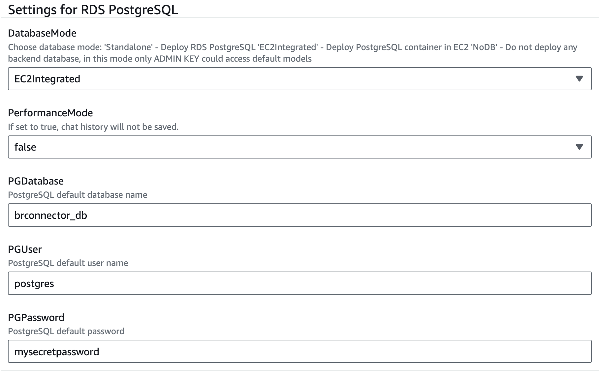
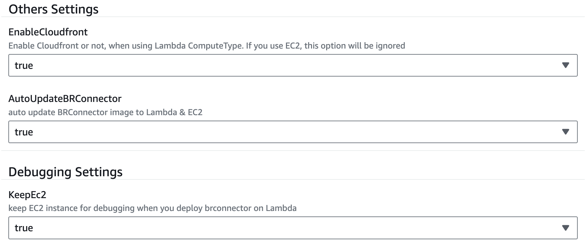
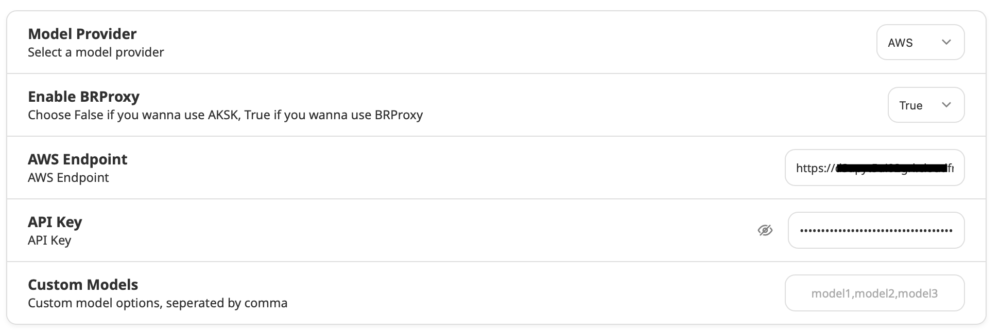

# 快速部署

使用 CloudFormation 进行快速部署。

## 支持的区域

所有部署形态（`ec2`、`lambda`、`lambda-web`、`ecs`）都可以用在这些区域：us-east-1、us-east-2、us-west-1、us-west-2、ca-central-1、sa-east-1、eu-west-1、eu-west-2、eu-west-3、eu-central-1、eu-north-1、ap-northeast-1、ap-northeast-2、ap-northeast-3、ap-southeast-1、ap-southeast-2、ap-south-1。

[Claude Code Web](../user-manual/scenarios/claude-code-web.md) 还需要 AgentCore Runtime，除 ap-northeast-3 外这些区域都提供，所以它不能在 ap-northeast-3 运行。

`lambda` 使用 AWS_IAM 认证时所需的 Lambda@Edge stack 始终部署在 us-east-1。

## 前提条件

1. 启用 Claude Sonnet 5.5 或 Haiku 5.5 - 如果您是首次使用 Anthropic 模型，请访问 [Amazon Bedrock 控制台](https://console.aws.amazon.com/bedrock/)，在左侧窗格底部选择 **Model access**。分别为 Claude Sonnet 5.5 或 Haiku 5.5 请求访问权限。
2. 为 BRConnector 部署 VPC 堆栈，或选择现有的 VPC 用于 BRConnector，记下 VPC ID、2 个公有子网 ID 和 2 个私有子网 ID
    - 这里提供了一个 cloudformation 模板，供您快速创建 VPC 并导出 VPC 参数以部署 BRConnector ([brconnector-vpc-cfn.yaml](https://github.com/aws-samples/sample-connector-for-bedrock/raw/main/cloudformation/brconnector-vpc-cfn.yaml))

## 组件

此 CloudFormation 模板将包含以下关键组件：

- Cloudfront
- 在 Lambda 或 EC2 上运行的 BRConnector
- RDS PostgreSQL、EC2 上的 PostgreSQL 容器或无数据库
- 启用了 pull through 缓存的 ECR

## 部署模式

以下是一些推荐的部署模式：

- 在 EC2 上部署带有集成数据库（或独立数据库）的 BRConnector，在 EC2 前面配置 Cloudfront

![[attachments/deployment/IMG-deployment-16.png|600]]

- 在 Lambda 上部署带有独立数据库（或无数据库）的 BRConnector，在公共 Lambda 函数 URL 前面配置 Cloudfront
- 在 Lambda 上部署带有独立数据库（或无数据库）的 BRConnector，在具有 AWS_IAM 授权类型的 Lambda 函数 URL 前面配置 Cloudfront

![[attachments/deployment/IMG-deployment-17.png|600]]

- 在 ECS 集群上部署带有独立数据库（或无数据库）的 BRConnector，在暴露 ECS 服务的 ALB 前面配置 Cloudfront

![[attachments/deployment/IMG-deployment-20.png|600]]

## 部署指南

- （如果需要带有 AWS_IAM 认证类型的 lambda 函数 URL，则必须执行此步骤）在 us-east-1 区域部署 lambda@edge 用于 Cloudfront Origin Request。部署成功后，从输出页面获取 lambda 版本 ARN。模板发布的版本是 `v2`；更新已有的 Lambda@Edge stack 后，把 BRConnector stack 的 `LambdaEdgeVersionArn` 参数设为新的 `LambdaEdgeVersionArn` 输出。<mark style="background: #FFB86CA6;">如果跳过此步骤，lambda 函数 URL 将是公开的。</mark>

[![[attachments/deployment/IMG-deployment.png|200]]](https://console.aws.amazon.com/cloudformation/home?region=us-east-1#/stacks/create/template?stackName=lambda-edge-use1&templateURL=https://sample-connector-bedrock.s3.us-west-2.amazonaws.com/lambda-edge-use1.yaml)

- 部署 BRConnector。下载 [quick-build-brconnector.yaml](https://github.com/aws-samples/sample-connector-for-bedrock/raw/main/cloudformation/quick-build-brconnector.yaml) 并上传到 Cloudformation 控制台，或点击此按钮直接启动。

[![[attachments/deployment/IMG-deployment.png|200]]](https://console.aws.amazon.com/cloudformation/home#/stacks/create/template?stackName=brconnector1&templateURL=https://sample-connector-bedrock.s3.us-west-2.amazonaws.com/quick-build-brconnector.yaml)

- VPC 参数
  - 首先部署 VPC 堆栈，并在此处填写堆栈名称。
  - 为 EC2/ECS 选择 2 个公有子网，为 Lambda 和 RDS 选择 2 个私有子网（子网组至少需要 2 个可用区）

![[attachments/deployment/IMG-deployment-18.png]]

- 计算参数
  - 为 BRConnector 选择计算类型，Lambda 或 EC2
  - EC2 设置
    - 目前仅支持 Amazon Linux 2023
    - 您可以选择在同一 EC2 上创建 PostgreSQL 容器（DatabaseMode 设为 `EC2Integrated`），或创建独立的 RDS PostgreSQL 作为后端（DatabaseMode 设为 `Standalone`）
  - Lambda 设置
    - `EcrRepo` 定义您的私有仓库名称前缀字符串
    - `LambdaArch` 定义您的 lambda 架构使用 arm64 或 amd64
    - 如果 `LambdaEdgeVersionArn` 为空，将使用<mark style="background: #FFB86CA6;">公共函数 URL</mark>。请确保此安全设置可接受
    - 您可以选择创建 RDS PostgreSQL（DatabaseMode 设为 `Standalone`）或不使用数据库（DatabaseMode 设为 `NoDB`）
- ECS 设置
    - 默认 ECS 任务 CPU 为 1024
    - 默认 ECS 任务内存为 2GB
    - ECS 服务中的默认任务数量为 2

![[attachments/deployment/IMG-deployment-19.png]]

- PostgreSQL 参数
  - DatabaseMode 选择：
    - `EC2Integrated` -- 在 EC2 中部署 PostgreSQL 容器
    - `Standalone` -- 部署 RDS PostgreSQL
    - `NoDB` -- 不部署任何后端数据库，在此模式下只有 ADMIN KEY 可以访问默认模型
  - 将 PerformanceMode 设置为 `true`，聊天历史将不会保存。
  - 默认 PostgreSQL 密码为 `mysecretpassword`



- 调试参数
  - 如果您选择 Lambda 作为计算类型，可以选择在所有资源部署成功后删除 EC2。此 EC2 用于临时编译和构建 BRConnector 容器。
  - 如果您选择 EC2 作为计算类型，请不要删除 EC2
  - 如果您将 AutoUpdateBRConnector 设置为 `true`，BRConnector 每晚自动更新，见 [AutoUpdate](#autoupdate)



- 部署成功后，转到输出页面并复制 Cloudfront URL 和第一个用户密钥到您的 bedrock 客户端设置页面。



- 您还可以使用 SSM 会话管理器连接到 `BRConnector` EC2 实例 ([docs](https://docs.aws.amazon.com/systems-manager/latest/userguide/session-manager-working-with-sessions-start.html#start-ec2-console))

## AutoUpdate

`AutoUpdateBRConnector` 为 `true` 时，stack 每晚 00:00 UTC 把 BRConnector 更新到 `latest`，即使 `BRConnectorVersion` 固定在其他版本也一样。

| ComputeType | 00:00 UTC 执行的内容 |
| --- | --- |
| `ec2` | 一个 SSM association 拉取 `latest` 镜像，镜像有变化时在实例上执行 `/root/brconnector-run.sh latest`。0.0.44 之前创建的 stack 没有这个脚本：association 改为重放第一次启动时记录的 `docker run` 行，并把标签换成 `latest`。每次执行还会限制 `/root` 下启动日志和密钥文件的权限。 |
| `lambda` | 一条 EventBridge 规则启动 CodeBuild 项目，项目把 `-lambda:latest` 镜像复制到您的私有 ECR 仓库并更新函数。 |
| `ecs` | 没有夜间任务。 |
| `lambda-web` | 没有夜间任务。`SourceRepoUrl`、`SourceRef` 或 `WebFnBuildId` 变化时，以及第一次更新到 0.0.44 模板时，更新 stack 会从 `SourceRepoUrl` 的 `SourceRef` 重新构建部署包并发布。只想重新构建时，修改 `WebFnBuildId`（例如从 `1` 改成 `2`）。 |

`lambda-web` stack 更新失败时，CloudFormation 通过重新构建上一个 `SourceRef` 来回滚，所以在更新完成之前，请保留这个 ref（分支或提交）。如果回滚构建也失败，stack 会停在 `UPDATE_ROLLBACK_FAILED`。用下面的命令恢复：

```sh
aws cloudformation continue-update-rollback --stack-name <stack name> --resources-to-skip WebFnPackage
```

`AutoUpdateBRConnector` 为 `false` 时：

- 转到 CodeBuild 页面，可以触发一个项目来手动更新 lambda 映像。单击“开始构建”。
- 由于没有创建 association，EC2 中的映像不会由 SSM State Manager 自动更新。请用 SSM 文档在 EC2 上手动执行更新。
- 检查您的 ECR 设置：如果拉取缓存页面中有规则，则已启用用上游仓库自动更新 ECR 映像的功能。

## 已有 stack 的模板更新

把 stack 更新到 0.0.44 模板会改变实例的 UserData，因此：

- `ec2` 实例会停止再启动一次，有一次短暂的中断。
- 创建时 `KeepEc2` 为 `false` 的 `lambda` 和 `lambda-web` stack 无法接受这次更新，因为辅助实例已经自行删除，需要重新创建。
- `lambda-web` 启动时会执行数据库迁移。更新前请先做数据库快照。
- 函数 URL 使用 AWS_IAM 认证时，把 `LambdaEdgeVersionArn` 设为新 Lambda@Edge stack（版本 `v2`）的输出。

## CloudFront 到源站

`ec2` 和 `ecs` 下，CloudFront 通过 HTTP 访问源站。`lambda-web` 从访问者到 Web Function 全程 HTTPS。

### 未启用拉取缓存的 ECR（仅适用于以前的 cfn 版本）

- 如果您未启用 ECR 拉取缓存，请按照此脚本手动更新映像

```sh
export AWS_DEFAULT_REGION=us-west-2
export ACCOUNT_ID=00000000000000
export PrivateECRRepository=your_private_repo_name

aws ecr get-login-password --region ${AWS_DEFAULT_REGION} | docker login --username AWS --password-stdin ${ACCOUNT_ID}.dkr.ecr.${AWS_DEFAULT_REGION}.amazonaws.com

# pull/tag/push arm64 image for lambda
docker pull --platform=linux/arm64 public.ecr.aws/x6u9o2u4/sample-connector-for-bedrock-lambda
docker tag public.ecr.aws/x6u9o2u4/sample-connector-for-bedrock-lambda ${ACCOUNT_ID}.dkr.ecr.${AWS_DEFAULT_REGION}.amazonaws.com/${PrivateECRRepository}:arm64
docker push ${ACCOUNT_ID}.dkr.ecr.${AWS_DEFAULT_REGION}.amazonaws.com/${PrivateECRRepository}:arm64

# pull/tag/push amd64 image for lambda
docker pull --platform=linux/amd64 public.ecr.aws/x6u9o2u4/sample-connector-for-bedrock-lambda
docker tag public.ecr.aws/x6u9o2u4/sample-connector-for-bedrock-lambda ${ACCOUNT_ID}.dkr.ecr.${AWS_DEFAULT_REGION}.amazonaws.com/${PrivateECRRepository}:amd64
docker push ${ACCOUNT_ID}.dkr.ecr.${AWS_DEFAULT_REGION}.amazonaws.com/${PrivateECRRepository}:amd64

# create/push manifest file
docker manifest create ${ACCOUNT_ID}.dkr.ecr.${AWS_DEFAULT_REGION}.amazonaws.com/${PrivateECRRepository}:latest --amend ${ACCOUNT_ID}.dkr.ecr.${AWS_DEFAULT_REGION}.amazonaws.com/${PrivateECRRepository}:arm64 --amend ${ACCOUNT_ID}.dkr.ecr.${AWS_DEFAULT_REGION}.amazonaws.com/${PrivateECRRepository}:amd64
docker manifest annotate ${ACCOUNT_ID}.dkr.ecr.${AWS_DEFAULT_REGION}.amazonaws.com/${PrivateECRRepository}:latest ${ACCOUNT_ID}.dkr.ecr.${AWS_DEFAULT_REGION}.amazonaws.com/${PrivateECRRepository}:arm64 --os linux --arch arm64
docker manifest annotate ${ACCOUNT_ID}.dkr.ecr.${AWS_DEFAULT_REGION}.amazonaws.com/${PrivateECRRepository}:latest ${ACCOUNT_ID}.dkr.ecr.${AWS_DEFAULT_REGION}.amazonaws.com/${PrivateECRRepository}:amd64 --os linux --arch amd64
docker manifest push ${ACCOUNT_ID}.dkr.ecr.${AWS_DEFAULT_REGION}.amazonaws.com/${PrivateECRRepository}:latest

```

- 使用正确的架构更新 lambda 映像

### 运行在 EC2 上的 BRConnector

- 登录到 ec2 以更新本地映像并重新启动 brconnector 容器。0.0.44 之前创建的 stack 没有 `/root/brconnector-run.sh`，请改为重放记录的那一行：`cat /var/log/cloud-init-output.log |egrep -o 'docker run .* --name brconnector .*' |sed 's/:[^:]\+$/:latest/' |sh`

```sh
aws ecr-public get-login-password --region us-east-1 | docker login --username AWS --password-stdin public.ecr.aws
docker pull public.ecr.aws/x6u9o2u4/sample-connector-for-bedrock
docker rm -f brconnector
bash /root/brconnector-run.sh latest

```


## 迁移到新的 PostgreSQL 数据库
您可以选择在 ECR 或 RDS 上的容器中直接部署 PostgreSQL，这里列出了一些命令供您在 PG 中迁移数据的参考。

### 将 BRConnector 数据从 EC2 上的 PG 容器迁移到 RDS
- 列出您的数据库名称
```sh
docker exec -it postgres psql -U postgres
postgres=> \l # 列出数据库
postgres=>

```
- dump 整库
```sh
docker exec -i postgres pg_dump -U postgres -d brproxy_dbname > db.sql

```
- 在 RDS 中找到您的 PG 端点 (Endpoint)
- 我们将在您的本地临时运行一个 docker 作为 postgres 客户端，而不是安装 postgresql
```sh
POSTGRES_VERSION=16
docker run --name postgres-client \
-e POSTGRES_PASSWORD=postgres-client-tmp-password \
-d postgres:${POSTGRES_VERSION}

```
- 复制整库导出的文件到新的容器中
```sh
docker cp db.sql postgres-client:/tmp/

```
- 创建目标数据库，然后导入数据
```
docker exec -it postgres-client sh 
# 
# psql -U postgres -h pg-endpoint.xxx.us-west-2.rds.amazonaws.com 
Password for user postgres:
postgres=> CREATE DATABASE brconnector_db;
postgres=> ^D
# psql -U postgres -h pg-endpoint.xxx.us-west-2.rds.amazonaws.com -d brconnector_db </tmp/db.sql
Password for user postgres:
# 
```
- 清理临时 docker on local
```sh
docker rm -f postgres-client

```

## 不支持的区域
中国区域暂时不支持部署，由于：
- Lambda URL 在中国区域不支持
- Cloudfront 在中国区域需要使用已备案的自有域名
- ALB 暴露 443 端口需要使用已备案的自有域名
