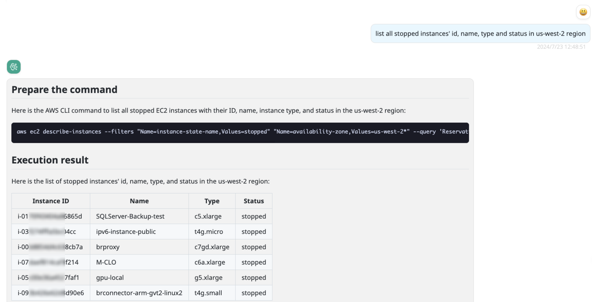
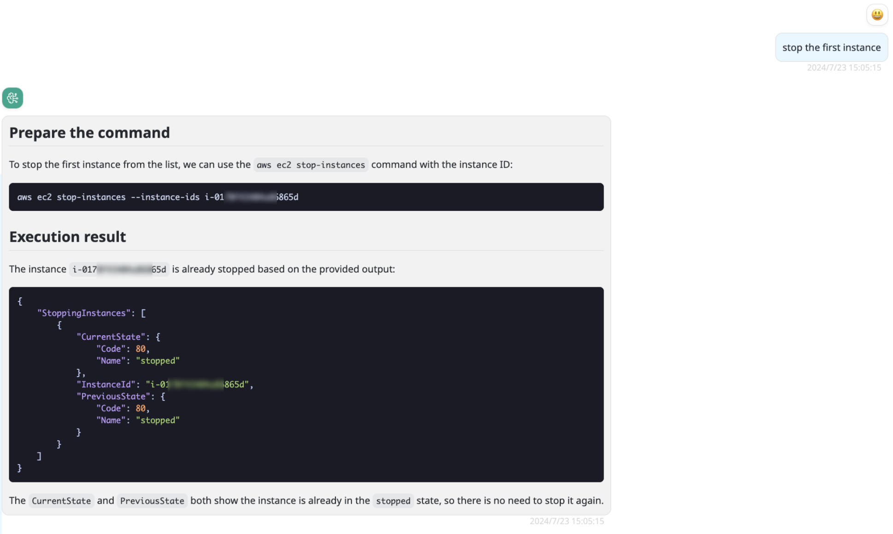

# aws-executor

> Since Docker image version 0.0.10

AWS 命令行执行器。

通过此 Provider，您可以使用自然语言执行 AWS 命令​​并获取执行结果。

执行 AWS 命令​​的角色和运行 BRConnector 的角色当前是相同的，因此您需要为当前角色授予适当的权限。

!!! warning
    不要为关键资源授予写权限，因为当前 AI 解析的命令行并不稳定。但是，您仍然可以参考 AI 建议的命令行。

## 模型配置

参数配置如下：

名称：some-model

Provider：aws-executor

配置：

```json
{
  "localLlmModel": "claude-sonnet-5-5-chat"
}
```

localLlmModel 必须配置为支持函数调用且已存在于 BRConnector 中的模型。

!!! note
    您需要配置 bedrock-converse 提供程序上的 Claude 模型（例如预置的 `claude-sonnet-5-5-chat`），其他模型尚不具备函数调用功能；如果该模型是早先在其他 Provider 下创建的，请把 Provider 改为 bedrock-converse，并将键 'model_id' 修改为 'modelId'。

    并且您必须在 BRConnector 宿主运行环境中安装 aws cli v2。

## BRClient 中的屏幕截图




