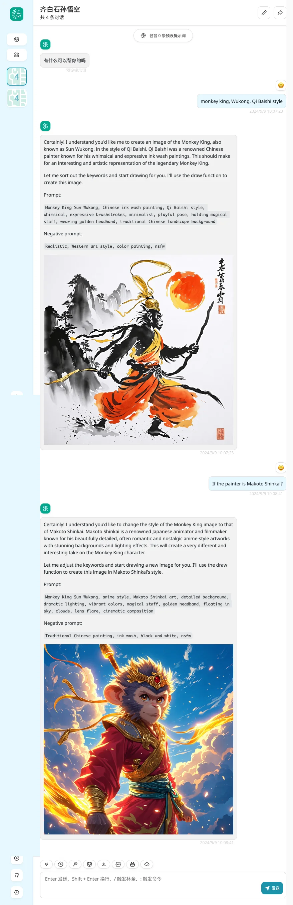
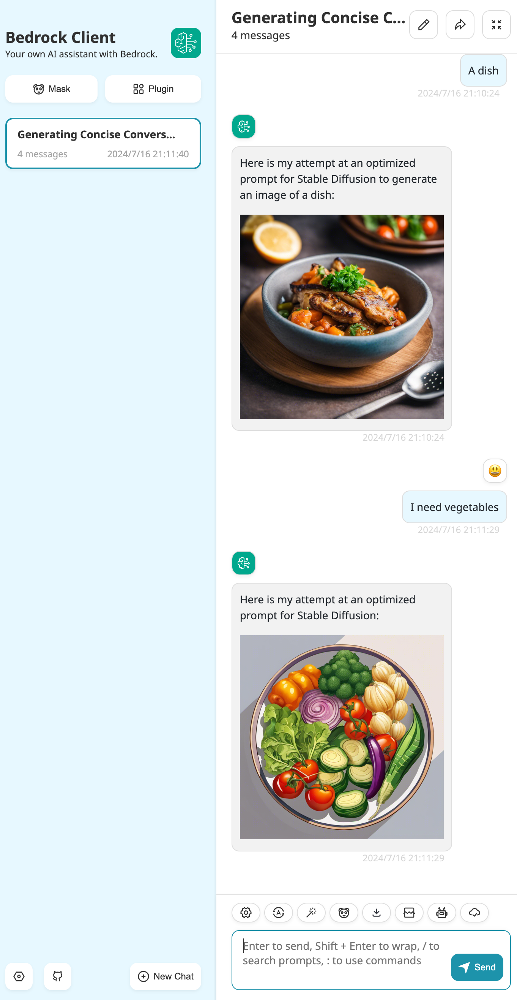
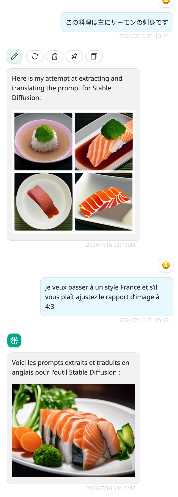

# painter

> Since Docker image version 0.0.9
> Updated in Docker image version 0.0.12
> Updated in Docker image version 0.0.13
> Updated in Docker image version 0.0.19

Draw using the bedrock paint model.

## Configuration

```json
{
  "regions": [
    "us-west-2"
  ],
  "s3Bucket": "<your-bucket>",
  "s3Prefix": "<your-prefix>",
  "s3Region": "us-east-1",
  "paintModelId": "stability.stable-image-ultra-v1:1",
  "localLlmModel": "claude-haiku-5-5-chat"
}
```

| Key     | Type      | Required     | Default value | Description |
| ------------- | -------| ------------- | ------------- | ------------- |
| localLlmModel  | string   | Y    |   | You should choose a native model for **function calling** |
| paintModelId  | string   | Y    |  |  Bedrock image gen model id. See the options below. |
| s3Bucket  | string   | Y    |  | S3 is for storing the generated images, please set the IAM permissions to meet access requirements.  |
| s3Prefix  | string   | N    | "" |   The S3 prefix combined with the date will ultimately form the S3 key.  |
| s3Region  | string   | Y     | | S3 bucket region  |
| regions  | string   | N     | ["us-east-1"] |   If you have applied and specified multiple regions, then a region will be randomly selected for the call. This feature can effectively alleviate performance bottlenecks.  |
| price_per_image  | number   | N     | 0 |   The price of one image, in the model's currency. Set it so that drawing is billed; see [Billing](#billing).  |

paintModelId options:

- stability.stable-image-ultra-v1:1
- stability.stable-image-core-v1:1
- stability.sd3-5-large-v1:0

These models are available only in us-west-2, so set `regions` to `["us-west-2"]`. For the current list, see [Model support by AWS Region](https://docs.aws.amazon.com/bedrock/latest/userguide/models-regions.html).

Then grant this model to  group or apikey.

## Billing

- Each drawing is billed at `price_per_image` for each image it returns, in the model's currency. For example, `"price_per_image": 0.04` bills 0.04 per image. A drawing that fails is recorded with 0 images.
- `price_per_image` is per **image**, not per token. When it is missing, blank, negative or not a number, images are recorded at 0, so set it to bill image generation, for example to the price of `paintModelId` in your Region on the [Amazon Bedrock pricing page](https://aws.amazon.com/bedrock/pricing/).
- The call that writes the drawing prompt goes to `localLlmModel` and is billed as a call to that model, at its prices.

## Features and Screenshots in BRClient

Features:

- Supports natural language conversation
- Supports multi-turn conversation to refine prompts
- Supports multiple languages
- Supports image size and aspect ratio ratio

Screenshots in BRClient:






