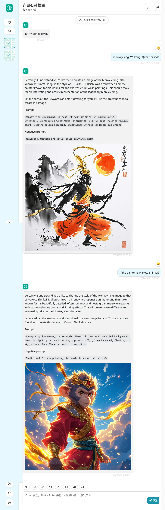
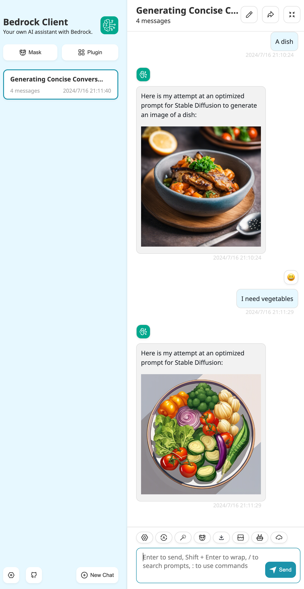
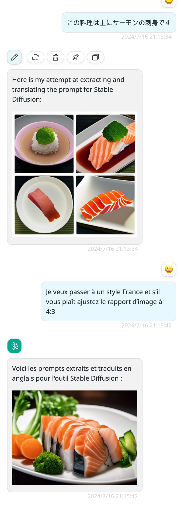

# painter

> Since Docker image version 0.0.9
> Updated in Docker image version 0.0.12
> Updated in Docker image version 0.0.13
> Updated in Docker image version 0.0.19

使用 Amazon Bedrock 上的 Stability AI 模型画图和改图。

用户在 BRClient 里可以只写一句话，也可以上传最多 5 张图片再写一句话。对话模型理解请求，从八种能力中选一种并调用。每张图片一做好就显示在回复里。

## 配置

```json
{
  "s3Bucket": "<your-bucket>",
  "s3Prefix": "<your-prefix>",
  "s3Region": "us-east-1",
  "paintModelId": "stability.stable-image-ultra-v1:1",
  "localLlmModel": "claude-haiku-5-5-chat",
  "image_prices": {
    "stability.stable-image-ultra-v1:1": 0.14
  }
}
```

| Key | Type | Required | Default value | Description |
| --- | --- | --- | --- | --- |
| localLlmModel | string | Y | | 理解请求并决定画什么的对话模型。它必须支持 **function calling**，并且能**看懂图片**。看不懂图片的模型分不清用户指的是哪一张。 |
| paintModelId | string | Y | | 文生图模型，可选值见下文。 |
| s3Bucket | string | Y | | 保存上传图片和生成图片的存储桶。请按[IAM 权限](#iam)授予访问权限。 |
| s3Prefix | string | N | "" | S3 key 前缀。生成的图片放在 `<s3Prefix>/<date>/`，上传的图片放在 `<s3Prefix>/uploads/<date>/`。 |
| s3Region | string | Y | | 存储桶所在的区域。 |
| image_prices | object | N | | 每个模型 ID 对应的单张图片价格，币种与模型相同。见[计费](#billing)。 |
| price_per_image | number | N | | 所有图片共用的单张价格，币种与模型相同。`image_prices` 里没有的模型 ID 使用它。见[计费](#billing)。 |

`paintModelId` 可以是如下的参数:

- `stability.stable-image-ultra-v1:1`
- `stability.stable-image-core-v1:1`
- `stability.sd3-5-large-v1:0`

`paintModelId` 决定文生图用的模型。它是 Ultra 或 SD3.5 Large 时，也决定图生图用的模型。Core 不能接收图片作为输入，所以选 Core 时，图生图使用 SD3.5 Large。

painter 现在忽略 `regions` 字段，设置了它会在日志里记一条消息。painter 为每个模型自己选区域，见[区域与数据驻留](#regions)。请把已有 config 里的 `regions` 删掉。

然后将此模型授予组或 api key。

## 用户可以怎么说

用户不需要知道工具名，也不需要固定格式。直接写想要什么，由对话模型选择能力。选错了，用户可以说明后再要求一次。

| 能力 | 模型 ID | 每张图片价格（美元） | 用户可以这样说 |
| --- | --- | --- | --- |
| 文生图 | `paintModelId` | 0.14（Ultra）、0.04（Core）、0.08（SD3.5 Large） | “画一座黎明时的灯塔” |
| 图生图 | Ultra 或 SD3.5 Large | 0.14（Ultra）、0.08（SD3.5 Large） | “把这张街景照片改成秋天的样子” |
| 搜索并替换 | `us.stability.stable-image-search-replace-v1:0` | 0.07 | “把猫换成狗” |
| 去除背景 | `us.stability.stable-image-remove-background-v1:0` | 0.07 | “去掉这张照片的背景” |
| 风格引导 | `us.stability.stable-image-style-guide-v1:0` | 0.07 | “照这幅画的风格画一个港口” |
| 风格迁移 | `us.stability.stable-style-transfer-v1:0` | 0.08 | “让我的照片看起来像这幅画” |
| 结构控制 | `us.stability.stable-image-control-structure-v1:0` | 0.07 | “保留这张照片的布局，改成冬天的场景” |
| 草图控制 | `us.stability.stable-image-control-sketch-v1:0` | 0.07 | “把我手绘的草图做成一张完整的海报” |

价格是撰写时的标价。当前价格见 [Amazon Bedrock 定价页面](https://aws.amazon.com/bedrock/pricing/)。

painter 不支持蒙版，所以不能做局部重绘、擦除物体或扩图。

### 一次请求里的多个步骤

一次请求最多执行 5 步。例如“取第一张图的风格，用在第二张上，再去掉背景”会执行两步。每一步的图片一做好就显示出来。每张图片前，流里会有一行，写明这一步的能力、模型和输入图片，用户可以据此检查对话模型有没有选对。

后面的消息可以引用之前的图片，例如“去掉最后一张的背景”。某一步失败时，请求停止。前面步骤的图片留在回复里，也已经计费。达到 5 步上限时，回复会说明，已经做好的图片保留。

非流式请求不会画图，它像以前一样转发给对话模型。BRClient 用这种请求给对话起标题。

在 `lambda` 计算类型上，一次请求最长 60 秒，两三步的链式请求就可能达到这个上限。每张图片一生成就计费，所以已经显示的图片仍然计费。需要更长的链式请求时，请使用 `ec2`、`ecs` 或 `lambda-web` 计算类型。

## 上传

- 一条消息最多 5 张图片，每张最多 10 MB。
- 支持 JPEG、PNG 或 WebP。HEIC 无法读取，请先转换格式。
- 图片超出所选模型的限制时，会返回错误，写明违反的规则和图片的实际值。
- Bedrock 过滤了提示词、输入图片或输出图片时，回复会说明是哪一个，不会显示错误堆栈。

上传的图片保存在 `<s3Prefix>/uploads/<date>/`，生成的图片保存在 `<s3Prefix>/<date>/`。BRConnector 不设置生命周期规则，图片会一直保留，直到您删除。

回复里生成的图片是 S3 预签名 URL 链接。URL 最长有效 4 小时。用临时凭证签名的 URL 在凭证过期时就失效。EC2 实例角色的凭证约 6 小时有效，所以对话里较早的图片可能不到 4 小时就打不开。

## 区域与数据驻留 {#regions}

painter 为每个模型选择区域。

- Ultra、Core 和 SD3.5 Large 始终在 us-west-2 运行。
- 六个 `us.stability.*` 图像服务，在 BRConnector 所在区域是 us-east-1、us-east-2 或 us-west-2 时，就在该区域运行；在其他区域时，在 us-west-2 运行。

`us.stability.*` 是跨区域推理配置文件，所以 Bedrock 可能把调用路由到另外两个美国区域之一。

BRConnector 运行在 us-east-1、us-east-2 和 us-west-2 之外时，提示词和上传的图片会发送到 us-west-2。有数据驻留要求的客户，请不要使用 painter。

## IAM 权限 {#iam}

运行 BRConnector 的角色需要：

- 目标区域的 `bedrock:InvokeModel`，覆盖基础模型和 `us.stability.*` 推理配置文件。
- 存储桶和前缀上的 `s3:PutObject` 和 `s3:GetObject`。

用 `aws:RequestedRegion` 限制区域的服务控制策略（SCP）会拦截对 us-west-2 的调用。调用返回 `AccessDeniedException` 时，回复会写明 BRConnector 调用的区域。

## 计费 {#billing}

painter 按如下顺序查找单张图片的价格：

1. 模型 config 里的 `image_prices[modelId]`。
2. 模型 config 里的 `price_per_image`。
3. 上表里的内置标价。内置标价以美元计，模型的币种不是美元时，请设置 `image_prices`。
4. 0，并在日志里记一条警告。缺少价格不会阻止调用。

每张图片按生成它的模型的价格计费。一次请求里有一步搜索并替换和一步去除背景，就按两张图片计费，每张 0.07。失败的步骤没有生成图片，不计费。

- 完全没有设置价格的 config，现在按内置标价计费。以前按 0 计费。
- 设置了 `price_per_image` 的 config，在设置 `image_prices` 之前，所有能力都沿用这一个价格。要让每种能力按自己的价格计费，请设置 `image_prices`。
- 对 `localLlmModel` 的调用，按对该模型的调用以它的价格计费。
- 价格仅供参考。painter 不会在调用前扣费，也不会因为额度而停止请求。

## BRClient 中的功能和截图

您可以在对话中包含如下信息：

- 支持自然语言对话
- 支持多轮对话以细化提示
- 支持多种语言
- 支持上传图片，用来修改或作为参考
- 支持宽高比（对支持宽高比的模型）

BRClient 中的截图：






