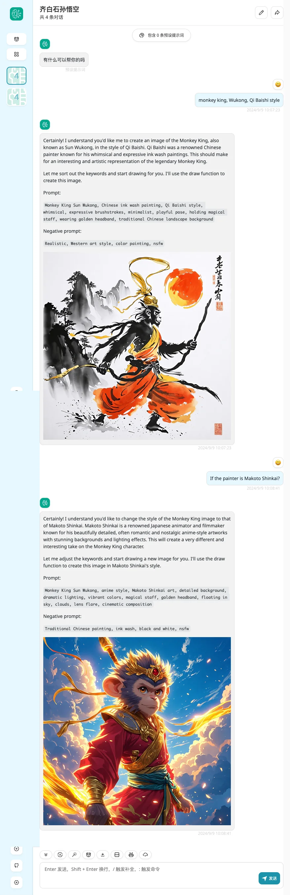
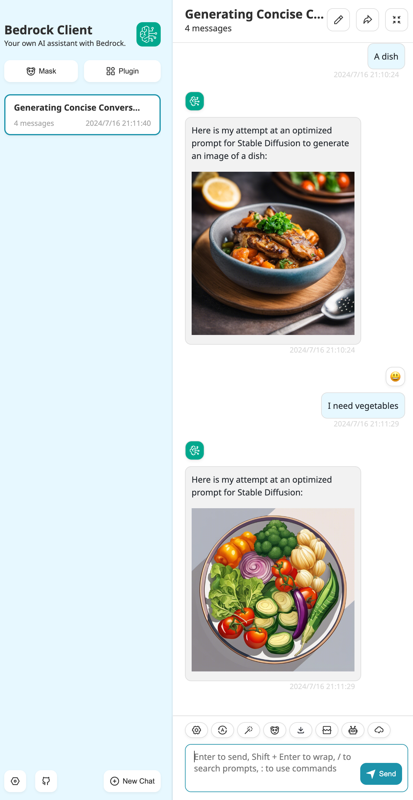
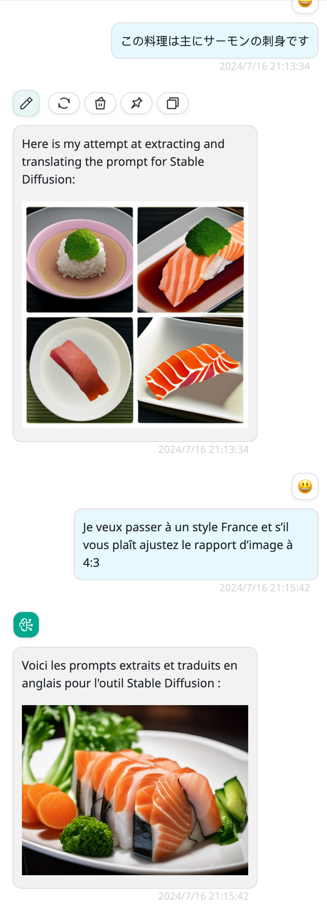

# painter

> Since Docker image version 0.0.9
> Updated in Docker image version 0.0.12
> Updated in Docker image version 0.0.13
> Updated in Docker image version 0.0.19

使用 Bedrock 画图模型

## 配置

```json
{
  "regions": [
    "us-east-1",
    "us-west-2"
  ],
  "s3Bucket": "<your-bucket>",
  "s3Prefix": "<your-prefix>",
  "s3Region": "us-east-1",
  "paintModelId": "amazon.titan-image-generator-v2:0",
  "localLlmModel": "claude-haiku-5-5-chat"
}
```

| Key     | Type      | Required     | Default value | Description |
| ------------- | -------| ------------- | ------------- | ------------- |
| localLlmModel  | string   | Y    |   | You should choose a native model for **function calling** |
| paintModelId  | string   | Y    | "stability.stable-diffusion-xl-v1" |  Bedrock image gen model id.   |
| s3Bucket  | string   | Y    |  | S3 is for storing the generated images, please set the IAM permissions to meet access requirements.  |
| s3Prefix  | string   | N    |  |   The S3 prefix combined with the date will ultimately form the S3 key.  |
| s3Region  | string   | Y     | | S3 bucket region  |
| regions  | string   | N     | ["us-east-1"] |   If you have applied and specified multiple regions, then a region will be randomly selected for the call. This feature can effectively alleviate performance bottlenecks.  |
| price_per_image  | number   | N     | 0 |   每张图片的价格，币种与模型相同。设置后画图才会计费，见下文“计费”一节。  |

paintModelId 可以是如下的参数:

- amazon.nova-canvas-v1:0
- stability.stable-image-core-v1:0
- stability.sd3-large-v1:0
- stability.stable-image-ultra-v1:0
- stability.stable-diffusion-xl-v1
- amazon.titan-image-generator-v1
- amazon.titan-image-generator-v2:0

然后将此模型授予组或 api key。

## 计费

- 每次画图按返回的图片数量，每张按 `price_per_image` 计费，币种与模型相同。例如 `"price_per_image": 0.04` 表示每张图片计 0.04。画图失败时按 0 张图片记录。
- `price_per_image` 按每**张图片**计，不是按 token 计。它缺失、为空、为负数或不是数字时，图片按 0 记录，所以请设置它，图像生成才会计费，例如设为 `paintModelId` 在您所在区域的价格，见 [Amazon Bedrock 定价页面](https://aws.amazon.com/bedrock/pricing/)。
- 生成画图提示词的调用发给 `localLlmModel`，按对该模型的调用以它的价格计费。

## BRClient 中的功能和截图

您可以在对话中包含如下信息：

- 支持自然语言对话
- 支持多轮对话以细化提示
- 支持多种语言
- 支持图像大小和宽高比

BRClient 中的截图：






