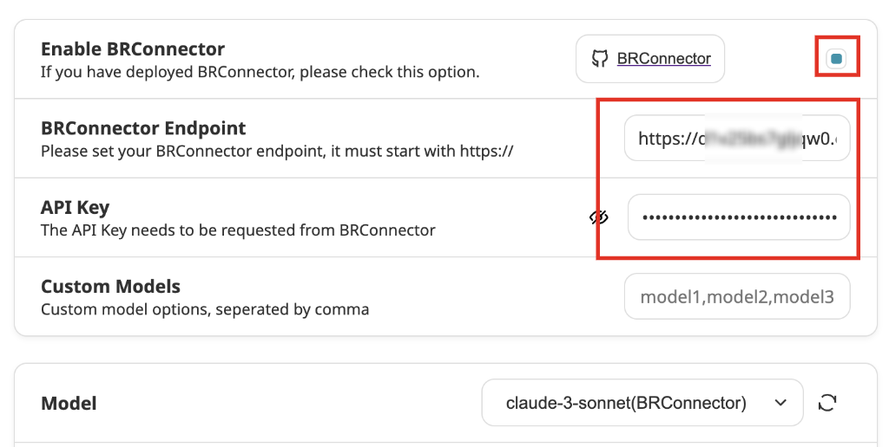

# Sample client for Bedrock

## Introduction

The Sample Client for Bedrock (BRClient) is a sample project that demonstrates how to build a client that connects to the Bedrock large language model.

In addition to being able to directly invoke Bedrock from the client, it can also set up this project (BRConnector) as its API backend.

Project URL: [aws-samples/sample-client-for-amazon-bedrock](https://github.com/aws-samples/sample-client-for-amazon-bedrock/)

## Quick Start

You can start BRClient directly from the source code or [download the installer for various platforms](https://github.com/aws-samples/sample-client-for-amazon-bedrock/releases).

If you have deployed the BRConnector project, you can start it directly through this URL: http(s)://your-endpoint/brclient/.

The web app at `/brclient/` is built from pinned upstream commits; see [BRClient source](../../home/deployment.md#brclient-source). Since BRConnector 0.0.45, a message with pictures in this web app has a Download button among its actions, which saves its pictures. A picture that the browser cannot save directly opens in a new tab instead.

## Settings

After entering the web interface, you need to enable BRConnector in the settings.

For the BRConnector Endpoint, simply fill in the root path of your BRConnector.

Fill in the API Key issued by BRConnector.

After setting it up, you can refresh the page to get the model list from BRConnector. Whenever you set up a new model, you can refresh the page to get the list of new models.
